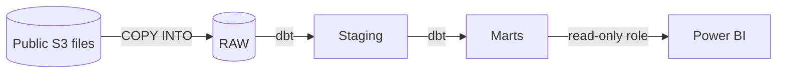

# Citibike and weather: an ELT pipeline in Snowflake and dbt

How does the weather affect Citibike use in New York City? This repository loads public Citibike trip data and New York weather readings into Snowflake, models them with dbt, and reports the results in Power BI.

## Architecture

| Layer | Location | Contents | Built by |
|---|---|---|---|
| Source | Public S3 bucket `snowflake-workshop-lab` | 376 gzip CSV trip files (1 Jun 2013 to 30 Jun 2018) and 61 gzip JSON weather files (5 Jul 2016 to 25 Jun 2019) | |
| RAW | `CITIBIKE_DB.RAW` | Data as received: trip values as text, weather as the original JSON, plus source file, line and load time | `setup/02_load_raw.sql` |
| Staging | `CITIBIKE_DB.STAGING` | Typed and cleaned trips and weather readings | dbt (in progress) |
| Marts | `CITIBIKE_DB.MARTS` | Daily and hourly trips joined to weather | dbt (in progress) |
| Reporting | Power BI | Weather and usage report | Power BI, read-only role (to come) |

Platform choices:

- Two roles: `TRANSFORMER` loads RAW and runs dbt; `REPORTER` is read-only, for Power BI.
- One XSMALL warehouse that suspends after 60 seconds idle, capped by a 15-credit resource monitor.
- dbt connects as a service user with key-pair authentication, so there is no password to leak.

## Repository

| Path | Purpose |
|---|---|
| `setup/00_setup.sql` | Snowflake platform: cost guardrail, warehouse, roles, database, dbt service user |
| `setup/01_explore_raw.sql` | Exploration of the raw files before loading, with findings |
| `setup/02_load_raw.sql` | Loads both sources into RAW, then checks the load |
| `docs/assumptions.md` | Findings, assumptions and decisions, updated as the project goes |
| `dbt_project.yml` | dbt project (models are added next) |

## How to rebuild

1. In Snowsight, as ACCOUNTADMIN, run `setup/00_setup.sql`: the first line on its own, then Run All.
2. Create a key pair and set the public key on `DBT_CLOUD_USER` (section 6 of `00_setup.sql`).
3. As TRANSFORMER, run `setup/02_load_raw.sql` one statement at a time, and compare each check with the expected result in its comment.
4. In dbt, run `dbt build` (once the models are in).

## Status

- [x] Snowflake platform
- [x] Raw data explored and loaded: 61,468,359 trips and 57,894 weather readings, every check passed
- [ ] dbt staging models and tests
- [ ] dbt marts
- [ ] Power BI report

## Highlights so far

- The weather files hold two places called "New York". Only city ID 5128581 is New York City; the other is about 280 km away and records six times as much snow.
- Weather times are UTC, while trip times are New York local time, confirmed by the commuter peaks at 08:00 and 17:00.
- The 8 days with no trips at all line up with three major snowstorms.

The reasoning behind every decision is in [`docs/assumptions.md`](docs/assumptions.md).
